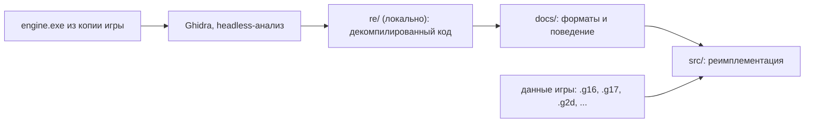

# Обзор проекта

**Кратко:** открытая реимплементация движка «Казаки II: Битва за Европу», работающая с данными оригинальной игры.

## Архитектура

Проект на стадии исследования: код движка ещё не написан.



## Структура каталогов

```
opencossacks-2/
├── README.md               — описание проекта
├── OVERVIEW.md             — этот файл
├── CHANGELOG.md            — история изменений
├── docs/                   — заметки о форматах и поведении движка
├── src/                    — исходники реимплементации (пока пусто)
├── tools/ghidra_scripts/
│   └── ExportDecomp.java   — выгрузка декомпилированного C-кода и индекса функций
└── re/                     — локально, в .gitignore: проект Ghidra, логи, вывод
```

## Основные модули

- `tools/ghidra_scripts/ExportDecomp.java`: скрипт Ghidra, записывает `functions.tsv` (адрес, размер, имя) и `engine.c` (декомпилированный код всех функций).

## Точка входа и запуск анализа

```sh
analyzeHeadless re/project engine \
  -import <путь к игре>/app/engine.exe \
  -scriptPath tools/ghidra_scripts -postScript ExportDecomp.java re/decomp \
  -analysisTimeoutPerFile 7200
```

## С чего начать и подводные камни

- Ghidra требует полноценный JDK 21 (не только JRE); путь задаётся в `support/launch.properties` → `JAVA_HOME_OVERRIDE`.
- `engine.exe` (GOG-сборка) импортирует `X3D8.DLL` вместо `d3d8.dll`: это GOG-прокладка, которая просто загружает системный `d3d8.dll` и делает паузу 500 мс после `CreateDevice`.
- Сборка собрана с инкрементальной компоновкой MSVC (секция `.textbss`), поэтому в ней много функций-переходников.
- Ничего из `re/` и файлов игры не коммитить.
