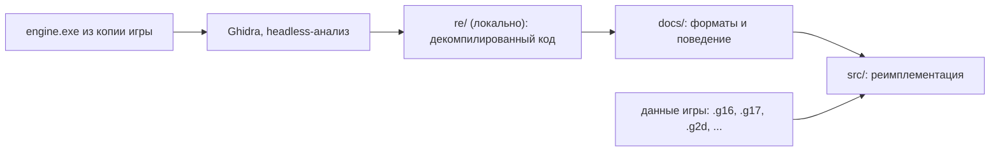

# Обзор проекта

**Кратко:** открытая реимплементация движка «Казаки II: Битва за Европу», работающая с данными оригинальной игры.

## Архитектура

Сейчас движок открывает окно (SDL3), выводит кадры через Vulkan 1.2 и показывает
главное меню игры, собранное из её же файлов (`Dialogs/v/M_Main.DialogsSystem.xml`):
фон, шрифты, тексты, кнопки с подсветкой при наведении. Библиотека `oc2_assets`
читает спрайты `.g2d`, `.g16`, `.g17`, картинки, XML и тексты.
Остальные подсистемы восстанавливаются по декомпилированному коду оригинала.



## Структура каталогов

```
opencossacks-2/
├── README.md               — описание проекта
├── OVERVIEW.md             — этот файл
├── CHANGELOG.md            — история изменений (генерируется git-cliff, вручную не правится)
├── cliff.toml              — настройки git-cliff: группы коммитов на русском
├── .github/workflows/build.yml — CI: Linux (.deb/.rpm) и Windows (.zip), релизы по тегам vX.Y.Z
├── docs/                   — заметки о форматах и поведении движка
│   └── formats/
│       ├── g2d.md          — пакеты спрайтов .g2d: заголовок, сетки кадров, кодировки, сжатие FLZ
│       └── g16.md          — спрайты .g16/.g17: разделы GU16/GN16/GPAL/GINF, блоки, плитки
├── CMakeLists.txt          — сборка (C++20); версия читается из src/core/version.hpp
├── CMakePresets.json       — пресеты: linux (Ninja), windows-msvc (Visual Studio 2022)
├── cmake/
│   ├── Dependencies.cmake  — загрузка зависимостей: SDL3, volk, Vulkan-Headers, VMA, bzip2, stb
│   └── Packaging.cmake     — пакеты CPack: .deb и .rpm (Linux), .zip (Windows)
├── packaging/linux/        — ярлык .desktop
├── src/
│   ├── main.cpp            — точка входа: ключи (--help), главный цикл, просмотр спрайтов
│   ├── core/version.hpp    — единственный источник версии и названия продукта
│   ├── assets/             — чтение форматов игры (библиотека oc2_assets, без графики)
│   │   ├── byte_reader.hpp — чтение little-endian с проверкой границ, FormatError
│   │   ├── audio_decode.*  — WAV (PCM 8/16), Ogg Vorbis (stb_vorbis), перевод в стерео 44,1 кГц
│   │   ├── sound_list.*    — группы звуков Sound\Sounds.xml (варианты, громкость, паузы)
│   │   ├── compression.*   — распаковка FLZ, LZO1X, bzip2 и блоков со стандартным заголовком
│   │   ├── economy.*       — цены рынка economy.txt (покупка/продажа, пределы, скорость сдвига)
│   │   ├── g16.*           — спрайты .g16/.g17: разделы, блоки, плитки, сборка кадров
│   │   ├── g2d.*           — пакеты спрайтов .g2d: таблицы, страницы, сборка кадров
│   │   ├── png.*           — запись PNG без внешних библиотек
│   │   ├── image_decode.*  — JPG, PNG, TGA, BMP через stb_image
│   │   ├── mission_options.* — настройки миссии из раздела MOPT: команды, нации, отключённые в одиночной игре
│   │   ├── mission_list.*  — миссии Missions\Missions.txt и выборки SingleMiss.txt / SingleBatl.txt
│   │   ├── map3d.*         — карты .m3d: разделы, высоты (SURF), фактуры (TILE, TIL2), объекты (TRE2), юниты (UNI3)
│   │   ├── sprite_list.*   — списки спрайт-объектов .lst (Treelist, stonlist, walls…): имя GP, привязка кадров
│   │   ├── weapon_list.*   — оружие weapon.nds: анимации эффектов, цепочки детей, звуки
│   │   ├── unit_desc.*     — описания юнитов .md (USERLC, SETANMPARAM, анимации) и члены наций .nds
│   │   ├── ai_script.*     — сценарии стратегического ИИ AI/*.ai.xml: папки, правила, цепочки условий, действия
│   │   ├── xml_tree.*      — разбор XML-диалекта игры (диалоги, настройки, состояния шейдеров)
│   │   ├── text_table.*    — тексты интерфейса «#КЛЮЧ текст» в порядке загрузки оригинала
│   │   ├── text_encoding.* — Windows-1251 ↔ UTF-8
│   │   ├── game_paths.*    — поиск файлов игры без учёта регистра
│   │   └── image.hpp       — изображение RGBA8
│   ├── platform/           — окно, звук
│   │   ├── window.*        — окно SDL3, события (клавиши, мышь, колесо), Vulkan-поверхность
│   │   ├── audio.*         — микшер SDL3: стерео 44,1 кГц, 32 голоса и музыка
│   │   └── sound_bank.*    — группы звуков Sounds.xml, музыка Music/*.ogg (случайная, не из 5 последних)
│   ├── world/              — мир игры без графики (библиотека oc2_world)
│   │   ├── terrain_mesh.*  — треугольники рельефа карты с освещением вершин
│   │   ├── lock_map.*      — непроходимые клетки 16×16 (вода, край карты, здания LOCKPOINTS) и путь A*
│   │   ├── market.*        — общий рынок: обмен ресурсов и сдвиг цен после сделки
│   │   ├── unit_catalog.*  — типы юнитов карты → описания .md через файлы наций (сначала файлы наций, sector*.nds — последними)
│   │   ├── strategic_ai.*  — стратегический ИИ игрока по сценарию его нации (стройка, производство, крестьяне)
│   │   ├── settlements.*   — нейтральные поселения: захват, доход владельцу, охрана (по Dip/*.dip.xml)
│   │   └── world.*         — юниты мира и шаг симуляции (40 мс): анимации, ходьба к точке
│   ├── ui/                 — интерфейс из данных игры
│   │   ├── fonts.*         — шрифты по именам оригинала (MenuTitleWhite, fonBlow_A, …) и из fonts.xml
│   │   ├── rich_text.*     — упрощённый DrawMultilineText: строки, перенос, теги {C…} {F…} {A…}
│   │   ├── dialogs.*       — окна *.DialogsSystem.xml: DialogsDesk, ListDesk (строки по образцу, выбор, прокрутка), BitPicture, GPPicture, TextButton, VitButton
│   │   └── menus.*         — стопка меню, действия кнопок (переходы, выбор карты, «Начать»)
│   └── render/
│       ├── vulkan_context.* — экземпляр и устройство Vulkan, VMA, цепочка обмена, кадры beginFrame/endFrame, снимки экрана
│       ├── sprite_renderer.* — текстуры и вывод текстурированных треугольников с альфа-смешиванием
│       ├── sprite_sheet.*  — пакет .g2d в видеопамяти: страницы-текстуры, рисование кадров
│       ├── terrain_renderer.* — рельеф: массив фактур с мип-картами, проекция X = x, Y = y/2 − z
│       ├── effects.*       — дым и вспышки выстрелов (анимации WEAPON.ADS по weapon.nds)
│       ├── map_objects.*   — деревья, камни, стены и юниты мира поверх рельефа, по мировому Y; отметка выбранных
│       ├── gp_images.*     — изображения по именам из данных (.g17 → .g16 → .g2d → Cash/), ленивая загрузка, окраска, отражение
│       ├── shaders/        — SPIR-V шейдеров в виде массивов C++ (генерируется, не править вручную)
│       └── vma.cpp         — реализация Vulkan Memory Allocator (единственная единица трансляции)
├── shaders/                — исходники шейдеров GLSL (sprite.vert, sprite.frag)
├── tests/                  — тесты на синтетических данных (check.hpp — мини-набор проверок)
├── tools/oc2-extract/      — утилита: выгрузка спрайтов в PNG, проверка чтения всех файлов
├── tools/compile_shaders.sh — компиляция shaders/ в src/render/shaders/ (нужен glslangValidator)
├── tools/ghidra_scripts/
│   ├── ExportDecomp.java   — выгрузка декомпилированного C-кода и индекса функций
│   ├── RunAnalysis.java    — автоанализ с замером времени анализаторов и отменой по флагу
│   ├── Coverage.java       — отчёт о покрытии кода функциями
│   └── SelectiveFix.java   — выборочный доанализ проблемных функций
└── re/                     — локально, в .gitignore: проект Ghidra, логи, вывод
```

## Основные модули

- `oc2::platform::Window` (`src/platform/window.hpp`): окно SDL3; `pumpEvents()` обрабатывает события, `createSurface()` создаёт Vulkan-поверхность.
- `oc2::assets::G2dFile` (`src/assets/g2d.hpp`): `parse()` читает пакет спрайтов и проверяет ссылки между таблицами; `decodePage()` даёт страницу-атлас в RGBA8, `renderFrame()` собирает кадр из треугольных частей.
- `oc2::assets::G16File` (`src/assets/g16.hpp`): `parse()` читает `.g16` и `.g17`, `decodeTiles()` даёт плитки кадра, `decodeFrame()` — собранный кадр в RGBA8.
- `oc2::assets::unpackBlock()` (`src/assets/compression.hpp`): распаковка сжатых блоков движка (1 — bzip2, 2/3 — LZO1X, 4 — FLZ); отдельно `flzDecompress()`, `lzo1xDecompress()`, `bzip2Decompress()`.
- `oc2::render::VulkanContext` (`src/render/vulkan_context.hpp`): выбор GPU (Vulkan 1.2+, дискретная карта в приоритете), цепочка обмена с пересозданием при изменении размера; кадр — между `beginFrame()` и `endFrame()`, `submitNow()` выполняет команды загрузки, `requestScreenshot()` сохраняет кадр в PNG.
- `oc2::render::SpriteRenderer` (`src/render/sprite_renderer.hpp`): `createTexture()` загружает изображение, `drawTriangles()` ставит треугольники в очередь, `flush()` записывает их в кадр.
- `oc2::assets::parseXml()` (`src/assets/xml_tree.hpp`): дерево `XmlNode` с удобными `intValue()`, `boolValue()`, `hexValue()` и др.
- `oc2::assets::TextTable` (`src/assets/text_table.hpp`): `loadGame()` читает тексты игры, `lookup("#КЛЮЧ")` возвращает строку в UTF-8.
- `oc2::assets::decodeImage()` (`src/assets/image_decode.hpp`): JPG/PNG/TGA/BMP → RGBA8.
- `oc2::assets::findCaseInsensitive()` (`src/assets/game_paths.hpp`): путь к файлу игры без учёта регистра (данные писались под Windows).
- `oc2::render::GpImages` (`src/render/gp_images.hpp`): `id("interf3\\Fonts\\FontG16")` → номер; `draw()` рисует кадр с цветовым множителем.
- `oc2::render::SpriteSheet` (`src/render/sprite_sheet.hpp`): пакет `.g2d` в видеопамяти; `draw()` рисует кадр.
- `oc2::assets::Map3d` (`src/assets/map3d.hpp`): `parse()` читает карту; `height()`, `facture()`, `worldX()/worldY()` — сетка 513×512 со сдвинутыми нечётными столбцами; `heightAt(x, y)` — высота в мировой точке; `objects()` — деревья и пр. (TRE2), `units()` — юниты (UNI3), `preview()` — мини-карта 256×240 (VIE2, ARGB4444), `startResources(игрок)` — начальные ресурсы (RESU, 8×8 int32).
- `oc2::assets::SpriteList` (`src/assets/sprite_list.hpp`): `parse()` списка `.lst` — имя GP и для каждого объекта привязка (dx, dy), кадр = номер.
- `oc2::assets::UnitDesc` (`src/assets/unit_desc.hpp`): `parse()` описания `.md`; `file(id)` — файл спрайтов USERLC, `animation("#STAND")` — кадры анимации; `parseNationMembers()` — раздел [MEMBERS] файла нации.
- `oc2::world::UnitCatalog` (`src/world/unit_catalog.hpp`): `find("SelFraDom4_3(SFR)")` → описание типа.
- `oc2::world::World` (`src/world/world.hpp`): `addUnit()`, `orderMove()` (путь A*), `orderAttack()`, `step()` — шаг симуляции; `cos256()/sin256()` — таблицы направлений оригинала.
- `oc2::world::Market` (`src/world/market.hpp`): `trade()` — продажа ресурса за другой по ценам `assets::Economy` (FUN_014ac380): получено = ROUND(объём · SELL[продаваемый] / BUY[покупаемый]), затем цены покупаемого тянутся к максимуму, продаваемого — к минимуму; возврат цен со временем (TIMERETURN) не сделан. Живёт в `World::market`.
- `oc2::world::LockMap` (`src/world/lock_map.hpp`): `fromTerrain()`, `addBuilding()`, `locked()`; `findPath()` — A* по 8 соседям со сглаживанием.
- `oc2::render::MapObjects` (`src/render/map_objects.hpp`): неподвижные объекты карты и юниты мира, `draw()` сливает их по мировому Y и отсекает по экрану.
- `oc2::world::buildTerrainMesh()` (`src/world/terrain_mesh.hpp`): треугольники рельефа построчно от дальних к ближним.
- `oc2::render::TerrainRenderer` (`src/render/terrain_renderer.hpp`): `setFactures()`, `setMesh()`, `draw()` с `MapCamera`.
- `oc2::ui::Fonts` (`src/ui/fonts.hpp`): `find("MenuTitleWhite")` → шрифт (изображение + цвет); кадр символа = байт Windows-1251.
- `oc2::ui::RichText` (`src/ui/rich_text.hpp`): `measure()` и `draw()` текста с разметкой внутри ширины; `View` переводит экран 1024×768 в пиксели окна.
- `oc2::ui::Dialog` (`src/ui/dialogs.hpp`): загрузка окна из XML в дерево `Widget` (координаты относительно родителя), `updateHover()`, `draw()`.

- `tools/oc2-extract/main.cpp`: утилита `oc2-extract` — `g2d <файл> <папка>` выгружает страницы и кадры в PNG, `check <папка игры>` читает все `.g2d` и сообщает об ошибках.

- `tools/ghidra_scripts/ExportDecomp.java`: скрипт Ghidra, записывает `functions.tsv` (адрес, размер, имя) и `engine.c` (декомпилированный код всех функций).

## Сборка и запуск

```sh
cmake --preset linux
cmake --build --preset linux-debug
./build/linux/Debug/opencossacks2 --version
./build/linux/Debug/opencossacks2 --frames 120   # дымовая проверка: 120 кадров и выход
./build/linux/Debug/opencossacks2 --screenshot shot.png   # один кадр в PNG
./build/linux/Debug/opencossacks2 --data <папка игры>/app   # главное меню
./build/linux/Debug/opencossacks2 --data <папка игры>/app --mouse 512,575 --screenshot menu.png   # меню с наведением
./build/linux/Debug/opencossacks2 --data <папка игры>/app --map Missions/Skirmish/Skirmish1.m3d   # карта
./build/linux/Debug/opencossacks2 --data <папка игры>/app --map Missions/Skirmish/Skirmish1.m3d --at 11939,14000 --screenshot village.png
./build/linux/Debug/opencossacks2 --data <папка игры>/app --map Missions/Skirmish/Skirmish1.m3d --at 13200,1700 --move 0,13000,1900 --frames 60 --screenshot walk.png
# на карте: левая кнопка — выбрать юнит (протяжка — рамкой), правая — идти (группа сохраняет строй) или атаковать врага, Esc — в меню
./build/linux/Release/opencossacks2 --data <папка игры>/app --map Missions/Battles/Battle1.m3d --at 9000,12600 --move 0,9600,12900 --frames 900 --screenshot battle.png
./build/linux/Debug/opencossacks2 --data <папка игры>/app --menu SingleBattles --mouse 405,725 --click --frames 10 --screenshot start.png   # «Начать» без мыши
./build/linux/Debug/opencossacks2 --data <папка игры>/app --sprite UnitsG17/FrnPopU.g2d   # просмотр спрайтов
ctest --test-dir build/linux -C Debug     # тесты, файлы игры не нужны
./build/linux/Debug/oc2-extract check <папка игры>/app   # прочитать все спрайты .g2d
./build/linux/Debug/oc2-extract g2d <файл.g2d> out/       # страницы и кадры в PNG
```

## Пакеты

```sh
cmake --build --preset linux-release
cd build/linux && cpack -G DEB -C Release   # .rpm требует rpmbuild (собирается в CI)
```

## CI и релизы

Каждый push в `main` и каждый PR собирают Linux и Windows в GitHub Actions; на Linux
движок проверяется на программном Vulkan (lavapipe) под виртуальным X-сервером.
Тег `vX.Y.Z` дополнительно создаёт GitHub Release с пакетами и заметками из коммитов;
теги с суффиксом (`-alpha.1` и т. п.) публикуются как предварительные выпуски.

Обновить журнал изменений: `npx git-cliff --config cliff.toml -o CHANGELOG.md`.

## Запуск анализа в Ghidra

```sh
analyzeHeadless re/project engine \
  -import <путь к игре>/app/engine.exe \
  -scriptPath tools/ghidra_scripts -postScript ExportDecomp.java re/decomp \
  -analysisTimeoutPerFile 7200
```

## С чего начать и подводные камни

- Первая настройка CMake скачивает и собирает SDL3 (около полутора минут); дальше работает кэш.
- В отладочной сборке слой проверки Vulkan включается автоматически, если установлен (`vulkan-validationlayers`).
- Сообщения о `validity error` в wayland-протоколах при сборке SDL безвредны.

- Ghidra требует полноценный JDK 21 (не только JRE); путь задаётся в `support/launch.properties` → `JAVA_HOME_OVERRIDE`.
- `engine.exe` (GOG-сборка) импортирует `X3D8.DLL` вместо `d3d8.dll`: это GOG-прокладка, которая просто загружает системный `d3d8.dll` и делает паузу 500 мс после `CreateDevice`.
- Сборка собрана с инкрементальной компоновкой MSVC (секция `.textbss`), поэтому в ней много функций-переходников.
- Ничего из `re/` и файлов игры не коммитить.
- После правки `shaders/` запустить `tools/compile_shaders.sh` и закоммитить `src/render/shaders/`: CI сверяет их.
- Текстуры и экран — в sRGB, поэтому смешивание идёт в линейном пространстве (в оригинале — в гамма-пространстве); на полупрозрачных краях возможна небольшая разница.
- Сжатие FLZ копирует 32-битными словами: при перекрывающихся ссылках побайтовое копирование даёт другой результат.
- В `.g16` первое u32 блока — размер буфера плиток, а не длина распаковки LZO; её ограничивает поле заголовка.
- `most.g16` и `mostshp.g16` используют метод блока 5, который не поддерживает и оригинал.
- XML диалогов — не стандартный XML: имена тегов с пробелами и «&», корень `<>`; «//» — комментарий только в начале строки. `Profile.xml` и `Shaders/DeviceStates/hud2_top_L.xml` повреждены в самих данных.
- Заголовок `.g2d` версии 5 на байт короче (нет байта флагов), таблица кадров начинается с 0x39.
- Разметка текста упрощена: ссылки `{R …}` и картинки `{I…}`, `{P …}`, `{G …}` пропускаются, высота строки — высота кадра «W»; оригинал (`DrawMultilineText`, `FUN_01058920`) учитывает ещё Top/Bottom/YShift из `fonts.xml`.
- Действия кнопок (`cva_MM_SinStart` и др.) пока только печатаются в консоль; работает лишь выход (`cva_MM_Close`).
- `grep` считает XML диалогов двоичными (Windows-1251): нужен `grep -a`.
- Рельеф рисуется иначе, чем в оригинале: тот строит 2D-кэш с одной фактурой на треугольник, случайными сдвигами текстуры и масками краёв (FUN_015590b0); здесь фактуры вершин смешиваются плавно. Вектор света подобран вручную.
- Порядок рядов рельефа (сверху вниз) заменяет буфер глубины — менять его нельзя.
- Часть изображений есть только в кэше `Cash/` в виде `.g16` с «_» вместо «\» (`STONES`, `WALLS`, `UnitsG17\SelFraDom4_3` → `Cash/UNITSG17_SELFRADOM4_3.g16`).
- У зданий (`BUILDING` в .md) кадры анимации — слои одной картинки (низ с тенью и верх), у остальных юнитов — кадры во времени. Кадры направления d в файле: d·(всего/поворотов)+кадр.
- Направление юнита 0..255: 0 — восток, по часовой стрелке (юг = 64), как в таблицах cos/sin оригинала (DAT_0216a818/DAT_0216a610). В файлах спрайтов 2·(повороты−1) направлений: от юга до севера, остальное — отражение.
- Панель игры — `dialogs\respanel.DialogsSystem.xml`; пока видна только верхняя полоса: ресурсы (ID кнопки = номер ресурса, FUN_013da8a0) и население. Панель рисуется с масштабом по высоте 768 без полей.
- Звук: наведение и нажатие кнопок (MouseSound/ClickSound окон), звуки юнитов на кадрах анимаций (SOUND в .md; видимые, по группе раз в кадр, не больше 8), SELECT_SOUND/ORDER_SOUND, фоновая музыка; `--mute` выключает звук. Без звукового устройства игра работает молча.
- Мини-карта в игре своя (оригинал рисует её кодом MiniMap4X.cpp): VIE2, точки юнитов цветом игрока, рамка видимой области; нажатие переносит камеру, M прячет.
- Ключ `--dialog <файл.xml>` открывает любое окно (удобно разбирать интерфейс).
- Выстрел (WEAPON w ИМЯ в .md): цепочка weapon.nds разворачивается сразу (случайный ребёнок), видимые звенья — анимации WEAPON.ADS (читается как .md; 255 поворотов = без направления) в точке дула, звук — из раздела [SOUND]. Снаряды не летят.
- Итог боя (упрощённо): раз в секунду проверяется, осталась ли живая команда одна (`World::winningTeam`); затем бой стоит и открывается окно EndGameMessage (`cva_VI_EndGame`: тексты Vic*/Def* и картинка из полей действия), «ОК» (`cva_MM_BackToMain`) — в главное меню. Условия миссий (захват зон) пока не учитываются. Ключ `--win` убивает врагов сразу.
- Добыча: источники — деревья и камни карты (раздел [SOURCES] у treelist.rsr и stonlist.rsr). Крестьянин работает TAKERESSTAGES циклов анимации ATTACKn, берёт PORTION, несёт (MOTION_Ln) к ближайшему своему зданию с RESOURCEBASE и сдаёт его в пределах 320 единиц. Номера анимаций по ресурсу выведены из описаний крестьян. Источники не истощаются. Склады на картах сражений нейтральные: свой нужно сначала построить.
- Стройка: панель внизу справа (своя раскладка; оригинал рисует её кодом) — значки BIGICON членов [FIXED_PRODUCE] выбранного крестьянина на сетке 12 столбцов. Нажатие на здание — выбор места (призрак: зелёный — можно, красный — нельзя; правая кнопка или Esc — отмена), левая кнопка — заложить: списывается PRICE, здание на стадии 0 занимает BUILDLOCKPOINTS, выбранные крестьяне идут к точкам BUILDPOINTS. Стадии — как OneObject::NextStage: жизнь = стадия·LIFE/BUILDSTAGES, картинка #BUILDLO_k (k = стадия·4/стадий), в конце — #STANDLO и клетки LOCKPOINTS. Стадия прибавляется каждым законченным циклом @WORK строителя (своё упрощение). Правая кнопка у своей стройки — достраивать; ключ --build <тип>. Юниты под новым зданием уходят к ближайшей открытой клетке.
- Производство: выбор здания нажатием (своё прочтение: ближайшая точка земли здания в 110 пикселях), на панели — его юниты из [FIXED_PRODUCE]; нажатие списывает PRICE и ставит в очередь. Время — BUILDSTAGES юнита в шагах (приказ FUN_00e4fe60 прибавляет GameSpeed = 256 к счётчику до стадий·256): крестьянин 650 шагов (26 с), мушкетёр 15. Юнит появляется в первой точке BORNPOINTS2 (x, 2y от угла здания; BORNPOINTS — в клетках), смотрит и идёт ко второй; звук BORN_SOUND. На значке — полоса готовности и точки очереди. Ключ --produce <здание>,<юнит>.
- Поля: объекты «CO» карты — стадии complex.lst (FG0…FG24 растут, FW0…FW11 сжинаются); переходы complex.rsr: [TIMETRANSFORM] со временем, [WORKTRANSFORM] за циклы работы крестьян; источник еды — только стадии из [SOURCES] (FG24, FW0…FW5). Единица времени перехода — шаг (своё допущение, World::kTransformTimeSteps). Оригинал рисует поля трёхмерным FieldPatch; здесь — четыре пучка колосьев Field.g2d на объект, высота по стадии (рост/50 · YScale/256). Крестьянин у иссякшего поля переходит к ближайшему с тем же ресурсом (в 600 единицах). Посев: у мельницы на панели «Поле» (SPRITEOBJECT, EXSPRITES FG0) — выбор места, квадрат 3×3 объектов FG0 через 64 единицы (своя раскладка; числа EXSPRITES не разобраны), цена PRICE за квадрат.
- Шахты (PEASANTABSORBER, PRODUCER): правая кнопка на шахте — выбранные крестьяне идут и входят (пропадают с карты, не выбираются и не цели). Ничья шахта (игрок 7) при входе становится своей — своё упрощение, разбор CheckMineCaptureAbility не закончен. Доход как FUN_01596b80: за шаг (a + b·крестьян)·256/8 тысячных ресурса PRODUCER (у рудников a = 0, b = 5 — 4 единицы в секунду на крестьянина). Выбранная шахта показывает на панели значок крестьянина — нажатие выпускает одного. Ключ --mine.
- Население (как пересчёт thunk_FUN_00dcec00): занято — живые не-здания без NOFARM (крестьяне места не занимают), предел — сумма MFARM готовых зданий (дома, казармы, ратуша). Юнит без NOFARM ждёт в очереди, пока мест нет. На верхней панели — «занято/предел». Прибавки к пределу за поселения (поле 0xd5 × число поселений) пока нет.
- Расход: RESCONSUMER РЕС n каждого живого юнита (у крестьянина — FOOD 8) суммируется по игроку; списывается раз в секунду по частям, числа считаются за минуту игрового времени (своё допущение — код списания не найден). Запас не уходит ниже нуля. Голод (`World::starving`): еды 0, а расход не покрыт — раз в 5 секунд каждый едок теряет 1/20 LIFE, обучение едоков стоит (своё прочтение энциклопедии, мораль — позже). Правая кнопка у дерева или камня — добывать; ключ --gather <и>.
- Расход на выстрел: RASTRATA_NA_VISTREL w n РЕС кол … (`UnitDesc::shotCost`) — оружие не выбирается, пока игроку не хватает ресурсов (`World::canShoot`), при выстреле списывается. RASTRATA_NA_VISTREL2 (у артиллерии «4 5 1 COAL 200», смысл не установлен) пока не разбирается.
- Разброс выстрела RAZBROS (`World::shotVictim`, FUN_00f2c8c0 — делитель 32000 найден по дизассемблеру): точка прицеливания сдвигается на (r−512)·d·RAZBROS/32000 по каждой оси, d = ((max(|dx|,|dy|)+|dx|+|dy|)/2)/32, r = 0..999; попадает ближайший враг к этой точке в радиусе 24 + UNITRADIUS (своё допущение — снарядов со столкновением нет). Генератор — свой LCG вместо таблицы RandNew оригинала.
- Волна атаки ИИ (`StrategicAi::sendWave`): в .ai.xml атак нет (бригадный ИИ оригинала бинарный), поэтому своё прочтение — раз в 180 игровых секунд (24 шага/с) свободные боевые юниты, если их не меньше 8, идут на ближайшего к центру группы врага.
- ИИ (своё упрощение): юниты команд, кроме команды игрока, раз в 5 с без дела идут на ближайшего врага в радиусе 2500 (крестьяне не ходят).
- Стратегический ИИ (`StrategicAi`): сценарий нации — по AI/router.xml, иначе любой AI/*.ai.xml с кодом нации. Раз в 25 шагов проверяются условия папок и правил (цепочка — И), выполняются действия Build, Produce, AddResources, BuyResource, PeonsDistribution. Код классов AI_Folder/AI_Trigger оригинала не разобран, кроме времени: GamingTime и OnceInPeriod — секунды по 24 шага (FUN_015f4e80). Свои допущения: за раздумье — не больше одной новой стройки; пока у игрока нет здания, принимающего ресурсы, строятся только такие (иначе тупик); место — по спирали от первого здания, не ближе 160 к источникам, NearTrees/NearStones — источник в 400; Build для не-здания — производство; производство — в здании с самой короткой очередью до PackSize/MaxAmount/предела населения; свободные крестьяне — в шахты (до 1/3 крестьян, по 5 в шахте), остальные — на дерево, камень, еду по нехватке относительно PeonsDistribution, без еды — посев у мельницы. BuyResource — продажа Amount ресурса ResTypeToSell на общем рынке (FUN_015d2c10; наличие здания рынка не проверяется), AmountOfSettlements — число захваченных поселений с ResType (с CheckUpgrades — не ниже Level), UpgradeSettlements — улучшение ближайшего к базе поселения с ResType до UpgLevel (цена·CostPercent/100, `Settlements::startUpgrade`), UpgradeIsRun ложно. Ключи `--ai-self` (ИИ и за игрока) и `--simulate <с>` (прогон без окна с отчётом по игрокам).
- Поселения (`Settlements`, по ProcessTribe из DipServer.dll): ядро — ничья (игрок 7) постройка BldMel/BldRudCoal/BldRudGold/BldRudIron с «(FR)», к нему — дома SelFraDom* в радиусе 1100; описание — Dip/<Ресурс>Neutral.dip.xml. Захват (раз в 8 шагов): защитников владельца с союзниками в радиусе меньше 10, охраны нет, все чужие — одной команды; поселение уходит игроку с наибольшим числом юнитов там, постройки перекрашиваются. Доход: каждые PeonTimeOnProduce шагов накопитель растёт на PeonMaxAmount, набрав ObozResAmount — ресурс сразу владельцу, пока его запас ниже MaxResAmount (крестьяне и обоз юнитами не выводятся). Охрана CopID рождается у ядра каждые CopBuidTime/2 шагов до CopMaxAmount. Все постройки разрушены — поселение ничьё и не действует. Шаг — в `MapView::stepWorld` после шага мира, до ИИ.
- Бой упрощён: оружие w (DAMAGE/ATTACK_RADIUS/ATTACK_PAUSE и анимация ATTACKw) выбирается по дальности, урон — на середине анимации, без снарядов, морали и построений. Союзы — команды из MOPT (`<Team>`), 7 — нейтральные; юниты игроков, отключённых в одиночной игре (DisableInSingle + AutoTransferUnitsToNearestTeam), отходят первому союзнику. Перезарядка ATTACK_PAUSE считается в шагах симуляции (предположение). Смерть — DEATH, затем DEATHLIE1.
- Симуляция: один шаг = 40 мс (обычная скорость), кадр анимации за шаг; ходьба — шаг из GEOMETRY в единицах 1/16 за кадр. Путь — A* по карте непроходимости; юниты расталкиваются на сумму UNITRADIUS (своё упрощение; стреляющие стоят на месте); поворот — по ROTATE, идёт, когда до цели меньше 45°. Карта непроходимости своя (вода глубже 16, край карты, LOCKPOINTS зданий от угла GetCornerXY), клавиша L или ключ --locks её показывают.
- Вода: как в оригинале (FUN_0168e650, BumpWater) — поверх земли ниже нуля облака `oblaka123g1.tga` с непрозрачностью (64 − 4·высота)/255, текстура привязана к экрану; имитация волн 256×256 заменена синусной рябью. Разделы SEA2/RIV1 к воде не относятся (SEA2 повторяет холмы — смысл не выяснен).
- Составные объекты TRE2 («CO», `complex.lst`) пока не выводятся; цвет игрока на юнитах не накладывается.

- Сводка выбранных юнитов (`drawSelectionInfo` в main.cpp): правее мини-карты имена типов («UNITSMD\ИМЯ.MD» из mdlist) и число, для одного юнита — здоровье с полосой. Проверка: `--map … --select-own` выбирает своих юнитов и ставит камеру на первого.

- Улучшения поселений (`Settlements::startUpgrade/peons`): Upgrades из .dip.xml (везде EffType PEASANT+) идут по порядку уровней, платит владелец, идёт Duration шагов (единица — своё допущение), Effect прибавляется к числу крестьян, а значит к доходу. Возврат цен рынка (TIMERETURN) не нужен: в economy.txt мин = нач = макс.

- Дерево развития (`assets/nation_tech.*`, `UnitCatalog::upgrade/upgradesAt`): из .nds читаются [ACCESSCONTROL] (требования типа — готовые здания и исследованные улучшения, `UnitDesc::needs`), [UPGRADE] (цена, время, действия) и [UPGRADEPLACE]. `World::available` закрывает постройку и производство без требований, `World::orderResearch` исследует улучшение в здании (время — шаги, своё допущение), `World::researched` — по игрокам. ИИ: PerformUpgrade и условие UpgradeIsRun (исследовано). Действия улучшений (LIFE, ATTRANGE, …) пока не применяются.

- Кампании в меню (`assets/campaign_list.*`, `Menus`): `Dialogs/campaign.xml` → список кампаний (окно CampSelect), карта кампании (окно CampXxx в CampaignMap), миссии `cva_Mission` открыты только пройденные плюс следующая; выбранная миссия — `startRequest_` (.m3d), победа (`campaignWon`) открывает следующую. Проверка кликов: `--menu Single --clicks "512,448;576,446;496,622;496,266;546,621"` (координаты меню 1024×768). Скрипты миссий (цели, триггеры) пока не разбираются.

- Настройки (`core/settings.*`, окно Options): ползунки VScrollBar (`WidgetKind::Slider`, кадры slider.g17: 0 бегунок, 1/2 линия, 3/4 концы — раскладка угадана), флажки переключаются кликом. Принять сохраняет ~/.config/opencossacks2/settings.ini; громкость звуков (`Audio::sfxVolume`), музыки и скорость прокрутки применяет main каждый кадр. Выпадающие списки (разрешение, анимация) пока пустые.

- Меню игры (F10game, `Ma_F12game`): Esc в игре открывает его поверх карты (карта стоит), повторно Esc — закрывает. Вариант панели «Main» выбирает режим (`cva_InGameMenu_MainDesk_Set` → `Menus::mainDesk_`: SinBattles по умолчанию, SinGlobalMap — кампания). Работают: вернуться, настройки (те же `Settings`), перезапуск миссии (`cva_MM_ReplayCurMiss`, `lastStart_`), выход в главное меню с подтверждением. Сохранить/загрузить — пока нет. Проверка: `--map … --esc --clicks "512,379"` (Esc на кадре 1).
- Описание миссии кампании: виджет «Camp Miss Description» берёт текст по descriptionKey следующей миссии (в данных статичный «#MissDesc1»).
- Сценарии миссий (`world/mission_script`): XML из раздела SXML карты (правила MAIN_INIT/MAIN_SCRIPTS, фильмы-диалоги, переменные, группы, зоны ZON2) выполняются интерпретатором; задачи, диалог, плашка сообщений и итог (ShowVictory/LooseGame) выводятся в игре; ИИ врагов запускает StartAIEx; озвучка реплик из Ogg задаёт темп диалога; Пробел пропускает диалог. Поддержана часть условий и действий, остальные логируются один раз.
- Сценарии миссий: добавлены SetUpgradeEnableStatus, TakeWood/Food/Stone, ChangeFriends; бригадные выражения возвращают 0, декоративные операции (туман, свет, приказы) игнорируются без шума; `orderResearch` учитывает запрещённые улучшения.
- Прогресс кампаний (`campaign_N=done`) сохраняется в настройках и восстанавливается при запуске.
- Сценарии миссий: PutNewSquad/PutNewFormation (появление отряда в зоне, в группе по имени), Teleport, TakeWood/Food/Stone (группа идёт добывать), камера фильмов (MoveCamera → клетка mX,mY вектора, AttachCameraToGroup, FreeCamera; камера держится только пока идёт фильм). Текст итога из ShowVictory/LooseGame показывается в окне EndGameMessage. Размер отряда (SizeType ≥ 100 — 12 юнитов) и смещения Teleport — упрощение.
- `--dump-script карта.m3d` печатает сценарий карты (SXML) и выходит.
- Эффекты улучшений: `World::finishResearch` применяет строки [UPGRADE] LIFE, SHIELD, ATTRANGE, SINGLE_ATTPAUSE, BUILD по игроку и типу (`World::mods`); жизнь, дальность, пауза и время стройки/производства берутся через `maxLife`/`attackMax`/`attackPause`/`buildStages`. Допущения: «200%» без знака — ×2, щит вычитается из урона (не меньше ¼). Не применяются: COST, EFFECT_*, HEALING, RAZBROS, DAMAGE.
- Таблица игроков стычки (cva_BR_*): ComboBox (свой рисунок, список поверх окна) для нации и «Нет игрока», цвет и команда по клику; настройки `Menus::slots` применяются к карте при запуске (замена нации в типе юнитов, команды, отсутствие игрока и его ИИ).
- Текстовый ввод (InputBox, SDL_EVENT_TEXT_INPUT, `--type` для проверок) и профили игрока: список, создание (имя, нация, сложность), удаление; хранятся в settings.ini, сложность профиля идёт в миссии; первый вход в «Одиночную игру» открывает создание профиля.
- Сохранения (`src/world/savegame.*`): симуляция детерминирована, поэтому файл `~/.config/opencossacks2/saves/ИМЯ.sav` хранит не состояние, а карту, таблицу игроков, сложность, миссию кампании, шаг и журнал приказов игрока (`World::journal`, пишется только на время `MapView::PlayerInput`, вложенные приказы не дублируются). Загрузка строит игру заново и проигрывает приказы с тех же шагов без звуков. «Сохранить»/«Загрузить» меню F10 и вкладка «Загрузить» окна сражений, удаление с подтверждением. `--save-check` (с `--map`) проверяет запись, чтение и совпадение состояния после повтора.
