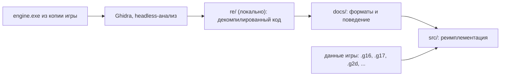

# Обзор проекта

**Кратко:** открытая реимплементация движка «Казаки II: Битва за Европу», работающая с данными оригинальной игры.

## Архитектура

Сейчас движок умеет открыть окно (SDL3) и выводить кадры через Vulkan 1.2,
а библиотека `oc2_assets` читает спрайты `.g2d`, `.g16` и `.g17`.
Остальные подсистемы восстанавливаются по декомпилированному коду оригинала.



## Структура каталогов

```
opencossacks-2/
├── README.md               — описание проекта
├── OVERVIEW.md             — этот файл
├── CHANGELOG.md            — история изменений (генерируется git-cliff, вручную не правится)
├── cliff.toml              — настройки git-cliff: группы коммитов на русском
├── .github/workflows/build.yml — CI: Linux (.deb/.rpm) и Windows (.zip), релизы по тегам vX.Y.Z
├── docs/                   — заметки о форматах и поведении движка
│   └── formats/
│       ├── g2d.md          — пакеты спрайтов .g2d: заголовок, сетки кадров, кодировки, сжатие FLZ
│       └── g16.md          — спрайты .g16/.g17: разделы GU16/GN16/GPAL/GINF, блоки, плитки
├── CMakeLists.txt          — сборка (C++20); версия читается из src/core/version.hpp
├── CMakePresets.json       — пресеты: linux (Ninja), windows-msvc (Visual Studio 2022)
├── cmake/
│   ├── Dependencies.cmake  — загрузка зависимостей: SDL3, volk, Vulkan-Headers, VMA, bzip2, stb
│   └── Packaging.cmake     — пакеты CPack: .deb и .rpm (Linux), .zip (Windows)
├── packaging/linux/        — ярлык .desktop
├── src/
│   ├── main.cpp            — точка входа: ключи (--help), главный цикл, просмотр спрайтов
│   ├── core/version.hpp    — единственный источник версии и названия продукта
│   ├── assets/             — чтение форматов игры (библиотека oc2_assets, без графики)
│   │   ├── byte_reader.hpp — чтение little-endian с проверкой границ, FormatError
│   │   ├── compression.*   — распаковка FLZ, LZO1X, bzip2 и блоков со стандартным заголовком
│   │   ├── g16.*           — спрайты .g16/.g17: разделы, блоки, плитки, сборка кадров
│   │   ├── g2d.*           — пакеты спрайтов .g2d: таблицы, страницы, сборка кадров
│   │   ├── png.*           — запись PNG без внешних библиотек
│   │   ├── image_decode.*  — JPG, PNG, TGA, BMP через stb_image
│   │   ├── xml_tree.*      — разбор XML-диалекта игры (диалоги, настройки, состояния шейдеров)
│   │   ├── text_table.*    — тексты интерфейса «#КЛЮЧ текст» в порядке загрузки оригинала
│   │   ├── text_encoding.* — Windows-1251 → UTF-8
│   │   ├── game_paths.*    — поиск файлов игры без учёта регистра
│   │   └── image.hpp       — изображение RGBA8
│   ├── platform/window.*   — окно SDL3, события, Vulkan-поверхность
│   └── render/
│       ├── vulkan_context.* — экземпляр и устройство Vulkan, VMA, цепочка обмена, кадры beginFrame/endFrame, снимки экрана
│       ├── sprite_renderer.* — текстуры и вывод текстурированных треугольников с альфа-смешиванием
│       ├── sprite_sheet.*  — пакет .g2d в видеопамяти: страницы-текстуры, рисование кадров
│       ├── shaders/        — SPIR-V шейдеров в виде массивов C++ (генерируется, не править вручную)
│       └── vma.cpp         — реализация Vulkan Memory Allocator (единственная единица трансляции)
├── shaders/                — исходники шейдеров GLSL (sprite.vert, sprite.frag)
├── tests/                  — тесты на синтетических данных (check.hpp — мини-набор проверок)
├── tools/oc2-extract/      — утилита: выгрузка спрайтов в PNG, проверка чтения всех файлов
├── tools/compile_shaders.sh — компиляция shaders/ в src/render/shaders/ (нужен glslangValidator)
├── tools/ghidra_scripts/
│   ├── ExportDecomp.java   — выгрузка декомпилированного C-кода и индекса функций
│   ├── RunAnalysis.java    — автоанализ с замером времени анализаторов и отменой по флагу
│   ├── Coverage.java       — отчёт о покрытии кода функциями
│   └── SelectiveFix.java   — выборочный доанализ проблемных функций
└── re/                     — локально, в .gitignore: проект Ghidra, логи, вывод
```

## Основные модули

- `oc2::platform::Window` (`src/platform/window.hpp`): окно SDL3; `pumpEvents()` обрабатывает события, `createSurface()` создаёт Vulkan-поверхность.
- `oc2::assets::G2dFile` (`src/assets/g2d.hpp`): `parse()` читает пакет спрайтов и проверяет ссылки между таблицами; `decodePage()` даёт страницу-атлас в RGBA8, `renderFrame()` собирает кадр из треугольных частей.
- `oc2::assets::G16File` (`src/assets/g16.hpp`): `parse()` читает `.g16` и `.g17`, `decodeTiles()` даёт плитки кадра, `decodeFrame()` — собранный кадр в RGBA8.
- `oc2::assets::unpackBlock()` (`src/assets/compression.hpp`): распаковка сжатых блоков движка (1 — bzip2, 2/3 — LZO1X, 4 — FLZ); отдельно `flzDecompress()`, `lzo1xDecompress()`, `bzip2Decompress()`.
- `oc2::render::VulkanContext` (`src/render/vulkan_context.hpp`): выбор GPU (Vulkan 1.2+, дискретная карта в приоритете), цепочка обмена с пересозданием при изменении размера; кадр — между `beginFrame()` и `endFrame()`, `submitNow()` выполняет команды загрузки, `requestScreenshot()` сохраняет кадр в PNG.
- `oc2::render::SpriteRenderer` (`src/render/sprite_renderer.hpp`): `createTexture()` загружает изображение, `drawTriangles()` ставит треугольники в очередь, `flush()` записывает их в кадр.
- `oc2::assets::parseXml()` (`src/assets/xml_tree.hpp`): дерево `XmlNode` с удобными `intValue()`, `boolValue()`, `hexValue()` и др.
- `oc2::assets::TextTable` (`src/assets/text_table.hpp`): `loadGame()` читает тексты игры, `lookup("#КЛЮЧ")` возвращает строку в UTF-8.
- `oc2::assets::decodeImage()` (`src/assets/image_decode.hpp`): JPG/PNG/TGA/BMP → RGBA8.
- `oc2::assets::findCaseInsensitive()` (`src/assets/game_paths.hpp`): путь к файлу игры без учёта регистра (данные писались под Windows).
- `oc2::render::SpriteSheet` (`src/render/sprite_sheet.hpp`): пакет `.g2d` в видеопамяти; `draw()` рисует кадр.

- `tools/oc2-extract/main.cpp`: утилита `oc2-extract` — `g2d <файл> <папка>` выгружает страницы и кадры в PNG, `check <папка игры>` читает все `.g2d` и сообщает об ошибках.

- `tools/ghidra_scripts/ExportDecomp.java`: скрипт Ghidra, записывает `functions.tsv` (адрес, размер, имя) и `engine.c` (декомпилированный код всех функций).

## Сборка и запуск

```sh
cmake --preset linux
cmake --build --preset linux-debug
./build/linux/Debug/opencossacks2 --version
./build/linux/Debug/opencossacks2 --frames 120   # дымовая проверка: 120 кадров и выход
./build/linux/Debug/opencossacks2 --screenshot shot.png   # один кадр в PNG
./build/linux/Debug/opencossacks2 --data <папка игры>/app --sprite UnitsG17/FrnPopU.g2d   # просмотр спрайтов
ctest --test-dir build/linux -C Debug     # тесты, файлы игры не нужны
./build/linux/Debug/oc2-extract check <папка игры>/app   # прочитать все спрайты .g2d
./build/linux/Debug/oc2-extract g2d <файл.g2d> out/       # страницы и кадры в PNG
```

## Пакеты

```sh
cmake --build --preset linux-release
cd build/linux && cpack -G DEB -C Release   # .rpm требует rpmbuild (собирается в CI)
```

## CI и релизы

Каждый push в `main` и каждый PR собирают Linux и Windows в GitHub Actions; на Linux
движок проверяется на программном Vulkan (lavapipe) под виртуальным X-сервером.
Тег `vX.Y.Z` дополнительно создаёт GitHub Release с пакетами и заметками из коммитов;
теги с суффиксом (`-alpha.1` и т. п.) публикуются как предварительные выпуски.

Обновить журнал изменений: `npx git-cliff --config cliff.toml -o CHANGELOG.md`.

## Запуск анализа в Ghidra

```sh
analyzeHeadless re/project engine \
  -import <путь к игре>/app/engine.exe \
  -scriptPath tools/ghidra_scripts -postScript ExportDecomp.java re/decomp \
  -analysisTimeoutPerFile 7200
```

## С чего начать и подводные камни

- Первая настройка CMake скачивает и собирает SDL3 (около полутора минут); дальше работает кэш.
- В отладочной сборке слой проверки Vulkan включается автоматически, если установлен (`vulkan-validationlayers`).
- Сообщения о `validity error` в wayland-протоколах при сборке SDL безвредны.

- Ghidra требует полноценный JDK 21 (не только JRE); путь задаётся в `support/launch.properties` → `JAVA_HOME_OVERRIDE`.
- `engine.exe` (GOG-сборка) импортирует `X3D8.DLL` вместо `d3d8.dll`: это GOG-прокладка, которая просто загружает системный `d3d8.dll` и делает паузу 500 мс после `CreateDevice`.
- Сборка собрана с инкрементальной компоновкой MSVC (секция `.textbss`), поэтому в ней много функций-переходников.
- Ничего из `re/` и файлов игры не коммитить.
- После правки `shaders/` запустить `tools/compile_shaders.sh` и закоммитить `src/render/shaders/`: CI сверяет их.
- Текстуры и экран — в sRGB, поэтому смешивание идёт в линейном пространстве (в оригинале — в гамма-пространстве); на полупрозрачных краях возможна небольшая разница.
- Сжатие FLZ копирует 32-битными словами: при перекрывающихся ссылках побайтовое копирование даёт другой результат.
- В `.g16` первое u32 блока — размер буфера плиток, а не длина распаковки LZO; её ограничивает поле заголовка.
- `most.g16` и `mostshp.g16` используют метод блока 5, который не поддерживает и оригинал.
- XML диалогов — не стандартный XML: имена тегов с пробелами и «&», корень `<>`; «//» — комментарий только в начале строки. `Profile.xml` и `Shaders/DeviceStates/hud2_top_L.xml` повреждены в самих данных.
- Заголовок `.g2d` версии 5 на байт короче (нет байта флагов), таблица кадров начинается с 0x39.
